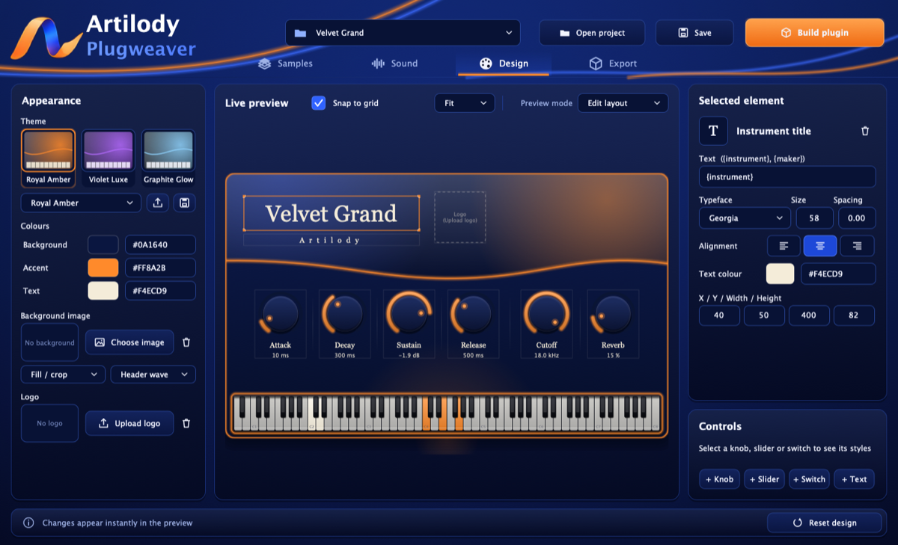
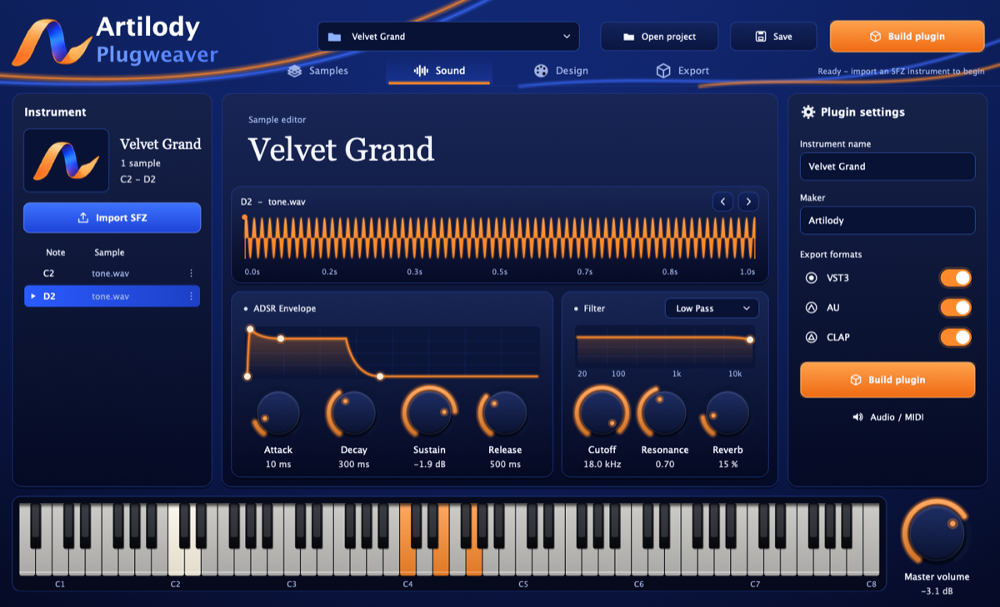
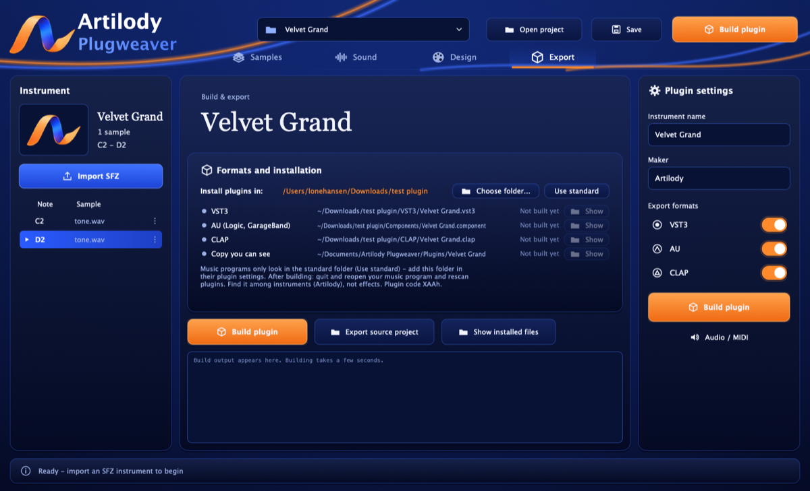

# Artilody Plugweaver

**Create your own sampler instrument plugins (VST3, AU and CLAP) from SFZ + WAV, without writing code and without a compiler.**

Import an SFZ instrument, shape the sound, design the plugin's look and press **Build plugin**. In a few seconds you have a finished, self-contained instrument installed for your music programs.

[Download the latest release](https://github.com/shenphenchoedron-hue/Artilody-Plugweaver/releases/latest) · [Dansk vejledning](README-DA.md)

## Features

- **SFZ import**: samples, root keys, key ranges and velocity layers.
- **Sound editor**:
  - waveform view
  - draggable ADSR envelope and filter curve (several filter types, resonance)
  - reverb and volume
- **Free layout designer**:
  - themes, colours, a background image and a movable logo
  - knobs, sliders and switches in 6 styles each, with a live preview
- **88-key keyboard (A0–C8)** in every plugin.
- **Shareable designs**: `.artitheme` templates hold graphics and layout only, never code.
- **Everything built in**:
  - The app contains a prebuilt plugin engine, so building an instrument needs no compiler, CMake, Git or internet.
  - All sounds and graphics are embedded in the plugin, so users of your instrument do not need Plugweaver.
- **You choose where plugins go**: Build plugin asks for the folder every time. Afterwards the app shows every file with its full path and a button that opens it in Finder or Explorer.
- **Source export** for developers: a complete C++/CMake project of the instrument.

## Download and install

| System | Installer |
|---|---|
| macOS 11+ (Intel and Apple Silicon) | `Artilody-Plugweaver-<version>-macOS.pkg` |
| Windows 10/11 x64 | `Artilody-Plugweaver-<version>-Windows-Setup.exe` |
| Ubuntu 22.04+ / Debian 12+ x64 | `artilody-plugweaver_<version>_amd64.deb` |

Get them from [Releases](https://github.com/shenphenchoedron-hue/Artilody-Plugweaver/releases). Neither the app nor the plugins need extra runtime files.

- **macOS:** The installer is not notarized by Apple. Right-click the `.pkg` → **Open** → **Open**, or go to System Settings → Privacy & Security → **Open Anyway**.
- **Windows:** SmartScreen may warn because the installer is not code-signed. Choose **More info** → **Run anyway**. By default the app installs for the current user only, without administrator rights.
- **Linux:** `sudo apt install ./artilody-plugweaver_<version>_amd64.deb`, then start it from the application menu or with `artilody-plugweaver`.

## Building a plugin

1. Choose the formats under **Export**: VST3, AU (macOS only) and CLAP.
2. Press **Build plugin** and choose the folder to install into. It starts in the folder you used last.
3. Plugins go into that folder's `VST3`, `Components` (AU) and `CLAP` subfolders. If the folder needs administrator rights, macOS asks for your password and Windows shows its UAC prompt.
4. Quit and reopen your music program and rescan plugins. You find the instrument among instruments, listed under its maker.

Music programs look in these standard folders:

| System | VST3 | AU | CLAP |
|---|---|---|---|
| macOS | `/Library/Audio/Plug-Ins/VST3` | `/Library/Audio/Plug-Ins/Components` | `/Library/Audio/Plug-Ins/CLAP` |
| Windows | `C:\Program Files\Common Files\VST3` | – | `C:\Program Files\Common Files\CLAP` |
| Linux | `~/.vst3` | – | `~/.clap` |

If you choose another folder, add it in your music program's plugin settings. A visible copy of every build is also saved in `Documents/Artilody Plugweaver/Plugins/<instrument>/`, together with a `Read me.txt`.

On macOS, plugins are universal (Intel and Apple Silicon) and ad-hoc signed with the built-in `codesign`. Pro Tools (AAX) is not supported.

## Building from source

You need a C++20 compiler, CMake 3.24+ and Git. The first build downloads JUCE 7.0.12 and clap-juce-extensions. It builds both the app and the plugin engine, which is embedded in the app.

| System | Command |
|---|---|
| macOS | `bash Build-Mac.command` (Apple Command Line Tools) |
| Windows | `Build-Windows.bat` (Visual Studio 2022 or Build Tools with "Desktop development with C++") |
| Linux | `bash Build-Linux.sh` (lists the required packages if they are missing) |

Installers are made with `packaging/mac/build-pkg.sh`, `packaging/windows/Plugweaver.iss` (Inno Setup 6) and `packaging/linux/build-deb.sh`.

[GitHub Actions](.github/workflows/build.yml) runs on every push, on macOS, Windows and Linux:
- builds and tests the app and the engine
- loads two engine-built instruments side by side in a VST3 host
- builds the installers and installs them
- lets the installed app build and install plugins
- on macOS, runs `auval`

### How the prebuilt engine works

Plugweaver ships one finished plugin per format. When you build an instrument, the app copies it and attaches a payload with the instrument's identity (name, maker, plugin code, CLAP id and version) and its project archive:
- macOS: as a resource inside the signed bundle
- Windows/Linux: appended to the plugin binary

The engine reads this payload when it loads. VST3 class id, AU subtype and CLAP id are derived exactly as in exported source projects. See [`PwPayload.h`](EngineTemplate/Source/PwPayload.h) and [`PwIdentity.h`](EngineTemplate/Source/PwIdentity.h).

### Project layout

| Path | Contents |
|---|---|
| `Source/` | The app: UI (`Main.cpp`, `Ui.h`), SFZ import, plugin building and installation (`Exporter.h`, `Install.cpp`) |
| `EngineTemplate/Source/` | Shared model, sound engine, plugin editor and processor, engine identity and payload |
| `Tests/` | Automatic round-trip, audio, export and plugin hosting tests |
| `packaging/` | Installers for macOS, Windows and Linux |
| `Docs/` | File formats and licences |

## Licence

The source code is licensed under [GPL-3.0-only](LICENSE). It uses JUCE 7.0.12 under GPLv3 and CLAP / clap-juce-extensions under MIT. See [Docs/LICENSES-DA.md](Docs/LICENSES-DA.md).

The Artilody logo and app icon are not covered by the GPL; see [Assets/LICENSE.txt](Assets/LICENSE.txt). Use only samples and images whose terms allow your intended distribution.
